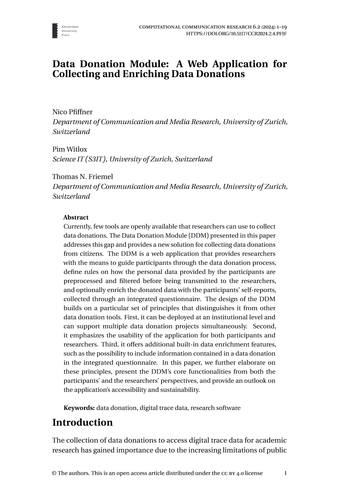

# DDM Documentation

**DDM** (Data Donation Module) is an open-source web application for collecting data
donations for academic research. In a data donation, participants request a copy of the
data that a platform such as YouTube or Instagram has collected about them, and share
selected parts of it with researchers.

DDM is developed and maintained by the [Data Donation Lab](https://datadonation.uzh.ch) at
the University of Zurich.

## Documentation Structure

- **[For Researchers](researchers/index.md)**: Set up and run data donation projects on an
  existing DDM server.
- **[For System Administrators](administrators/index.md)**: Install and run a DDM server.
- **[For Developers](developers/index.md)**: Contribute to DDM, or fork and extend it.

## Key Features


<div class="grid cards" markdown>

-   :material-clock-fast:{ .lg .middle } __Easy data donation configuration__

    ---

    Researchers can **configure** the data donation collection (including validation
    and extraction), **access collected data**, and **monitor** ongoing data collections
    through a **graphical user interface**.

    Project configurations can also easily be shared through the integrated 
    export-import functionality.

-   :material-dots-circle:{ .lg .middle } __Supports many platforms__

    ---

    Collect data donations from all platforms that provide a 
    text-based data export, including:
    
    - YouTube :material-youtube:
    - TikTok :simple-tiktok: 
    - Instagram :material-instagram:
    - ChatGPT :fontawesome-brands-openai:

-   :material-checkbox-marked-circle-outline:{ .lg .middle } __Integrated survey tool__

    ---

    DDM includes a built-in, modern survey tool supporting the most used survey
    functionality. 

    Furthermore, DDM can also easily be connected to your survey projects hosted 
    on other platforms (Qualtrics, Unipark, SoSci Survey, etc.).


-   :material-lock-alert:{ .lg .middle } __Privacy by design__

    ---

    DDM puts participant privacy first.

    **Local Processing:** Donated data is extracted in the participant's browser and
    only submitted after explicit consent.

    **Encryption:** All donated data is encrypted before storage.

    **Enhanced Encryption:** Encrypt a project's data with a password that only
    your team knows, so that not even the server administrators can read it
    (e.g., if you're dealing with health data).

</div>

## How a Data Donation Works

Participants go through these steps:

1. **Briefing page:** Participants learn about the study.
2. **Data donation:**
    1. Participants follow the instructions to request their data from the platform and
       download it.
    2. They upload the file to DDM.
    3. DDM extracts and filters the data according to the researcher's rules, in the
       participant's browser.
    4. Participants review the extracted data and decide whether to donate it.
3. **Questionnaire (optional):** Participants answer questions, which can refer to their
   donated data, for example to add context or to show participants insights into their
   own data.
4. **Debriefing page:** The last page, which can send participants on to another website,
   such as an external survey.

The content of a donation is sent to the researcher's server only after the participant
consents in step 2.4. For details, see
[Data Donation Overview](researchers/data_collection_configuration/datadonation/datadonation_overview.md).

## Design Philosophy

DDM is designed to be hosted by an institution, such as a university, a department, or a
research consortium, and to run many independent data donation projects at the same time.
It also works for a single project.

Researchers configure everything in a graphical user interface, without programming.

For more on DDM's design, see the [accompanying article](#how-to-cite-ddm).

## How to Cite DDM

If you use DDM in your research, please cite:

> Pfiffner, N., Witlox, P., & Friemel, T. N. (2024). Data Donation Module: A Web
> Application for Collecting and Enriching Data Donations. *Computational Communication
> Research*, 6(2), 1–19. [https://doi.org/10.5117/CCR2024.2.4.PFIF](https://doi.org/10.5117/CCR2024.2.4.PFIF)

```bibtex
@article{pfiffner2024ddm,
  author  = {Pfiffner, Nico and Witlox, Pim and Friemel, Thomas N.},
  title   = {Data Donation Module: A Web Application for Collecting and Enriching Data Donations},
  journal = {Computational Communication Research},
  year    = {2024},
  volume  = {6},
  number  = {2},
  pages   = {1--19},
  doi     = {10.5117/CCR2024.2.4.PFIF}
}
```

[{ width="220" }](https://doi.org/10.5117/CCR2024.2.4.PFIF)
