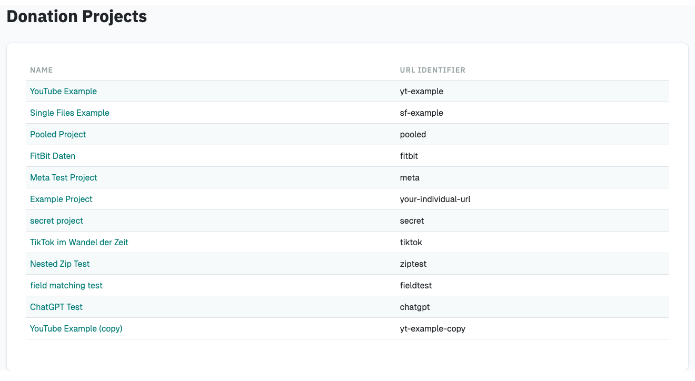
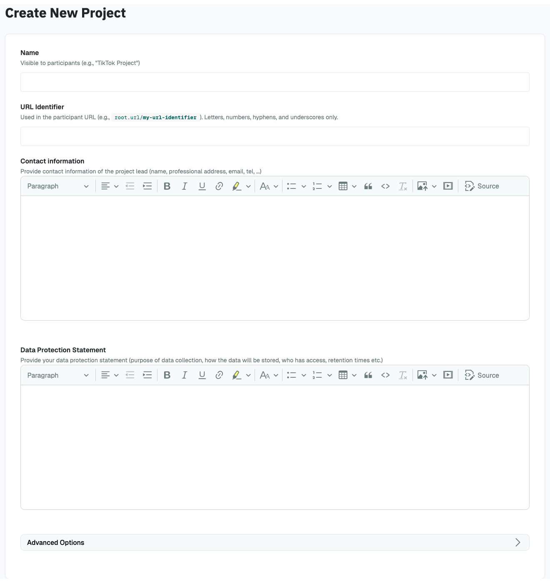

# Create a Project

## Project List

When you open DDM, you see a list of all your projects:

{ width="90%" }

To create a project, click **Create New Project**.

## Set Up a New Project

{ width="90%" }

Enter the project's name, URL identifier, contact information, and data protection
statement. For what each field means, see
[General Project Settings → Public Information](general_project_settings.md#public-information).
You can change all of these later.

### Advanced Options: Enhanced Encryption

DDM encrypts all collected data. By default, DDM can decrypt the data itself, so you can view
and download it without extra steps.

With **Enable enhanced encryption**, you set a project password when you create the project.
Donations and questionnaire responses can only be decrypted with this password. DDM doesn't
store it, so nobody without the password can read the data, including the administrators of
your DDM server. You'll need to enter the password whenever you download data, both in the
[Data Center](data_center/data_download.md) and through the [API](topics/apis.md).

Consider enhanced encryption if your data protection requirements say that only your research
team may be able to read the data.

!!! danger "Before you enable enhanced encryption"

    - **You can't change it later.** Enhanced encryption can't be turned on or off after you
      create the project.
    - **If you lose the password, you lose the data.** The password can't be recovered or
      reset. Store it in a password manager and share it with your team.
    - **Some features aren't available.** You can't refer to donated data in your
      questionnaire (see [Data Integration](data_collection_configuration/questionnaire/questionnaire_data_integration.md)).

For technical details, see [Developers → Encryption](../developers/topics/encryption.md).

## After Creating the Project

Click **Create Project**. DDM opens the [Project Hub](project_hub.md) of your new project.
