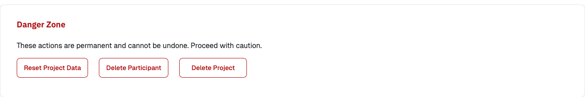

# Delete a Project or Data

{ width="95%" }

The Project Hub's **Danger Zone** section holds all options to reset or delete the data
collected in a project.

## Reset Project Data

With this option, you can delete all data collected for a given project. This removes all data
donations and questionnaire responses, and also removes the participant records themselves - so
the [Participation Statistics](data_center/participation_statistics.md) (started/completed
counts, etc.) reset to zero as well.

## Delete Participant

You can delete the data for a specific participant by providing their external participation id.

!!! tip

    You can show your participants their external participation id during the study
    (e.g., embedded in a _text block_ as part of the questionnaire or on the debriefing page)
    and inform them that by providing this ID they can request the deletion of their data in
    the future if they change their mind.

    This function can then help you to delete a participant from the database (if your
    study is still ongoing at the time a participant requests the deletion of their
    data).

## Delete Project

With this option you can delete the current project including all its components (e.g., Uploaders, Blueprints,
Instructions, Questions etc.). This will also delete all associated data.
