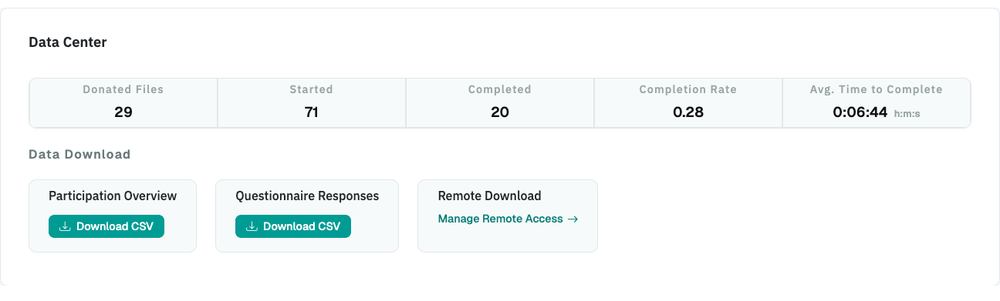

# Download

You can download your data in two ways:

- **In the Project Hub**, in the **Data Center** section. Described on this page.
- **Through the API**, with a script. See [Download Through the API](#download-through-the-api).

{ width="95%" }

For projects with
[enhanced encryption](../create_project.md#advanced-options-enhanced-encryption), you need
the project password for every download.

## Download Donations

In the Project Hub, you download donations one participant at a time:

1. In the **Data Center** section of the Project Hub, download the **Participation
   Overview**. It's a CSV file with one row per participant, including participants who
   didn't finish.

2. In the file, open the link in the `donation_download_link` column of the participant.
   Open it in the browser in which you're logged in to DDM.

Each donation is a JSON file with the data that each Blueprint extracted, using the field
names you defined under
[Relevant Fields](../data_collection_configuration/datadonation/datadonation_configuration.md#relevant-fields).

!!! tip "Download all donations at once"

    There's no button to download all donations at once. To download the donations of all
    participants, use the [API](#download-through-the-api).

### Participation Overview

The Participation Overview has these columns:

| Column                   | Description                                                                                                                                                                                                                              |
|--------------------------|------------------------------------------------------------------------------------------------------------------------------------------------------------------------------------------------------------------------------------------|
| `participant_id`         | The participant's ID.                                                                                                                                                                                                                    |
| `is_test_case`           | `True` if the participant used the [test link](../test_and_launch.md).                                                                                                                                                                   |
| `start_time`             | When the participant first opened the project, for example `2024-07-16 20:30:40.863581+00:00` (UTC).                                                                                                                                     |
| `end_time`               | When the participant reached the debriefing page.                                                                                                                                                                                        |
| `current_step`           | The last step the participant reached: `0` briefing, `1` data donation, `2` questionnaire, `3` debriefing.                                                                                                                               |
| `completed`              | `True` if the participant completed the study.                                                                                                                                                                                           |
| `url_parameter`          | All [extracted URL parameters](../general_project_settings.md#url-parameter-extraction) in one column, if enabled, for example `{"participant": "ID123", "channel": "email"}`. Split it into separate columns in your analysis software. |
| `extra_data`             | `briefing_consent` (`"1"` or `"0"`) if you ask for consent on the briefing page. For test runs, it may also contain internal test information (see [Test and Launch](../test_and_launch.md)).                                            |
| `donation_download_link` | The link to download the participant's donation.                                                                                                                                                                                         |

For each Blueprint, the file has these columns, where `<X>` is the Blueprint's ID:

| Column                    | Description                                                                                                                                                                                                                               |
|---------------------------|-------------------------------------------------------------------------------------------------------------------------------------------------------------------------------------------------------------------------------------------|
| `bp-<X>_name`             | The Blueprint's name. Use it to see which Blueprint the ID belongs to.                                                                                                                                                                    |
| `bp-<X>_time_submitted`   | When the participant submitted the donation for this Blueprint.                                                                                                                                                                           |
| `bp-<X>_consent`          | `True` if the participant consented to donate this Blueprint's data, `False` if not.                                                                                                                                                      |
| `bp-<X>_extraction_state` | `DATA_EXTRACTED`: data was extracted. `NOT_ATTEMPTED`: the participant reached the data donation step but didn't upload a file. `FAILED`: the upload or extraction failed. `NO_DATA_EXTRACTED`: the Extraction Rules removed all entries. |
| `bp-<X>_n_data_entries`   | The number of entries in the donation. For some data structures, the actual number may be higher.                                                                                                                                         |

!!! note "Test runs"

    Participants who used the [test link](../test_and_launch.md) are included and marked
    with `is_test_case = True`. Exclude them before you analyze the data. For exceptions,
    see [Test and Launch](../test_and_launch.md#test-runs-in-your-data-and-exports).

## Download Questionnaire Responses

In the **Data Center** section of the Project Hub, click **Download CSV** next to the
questionnaire responses.

The file has one row per participant and one column per question or item, named after its
**Variable Name** (see [Questionnaire Configuration](../data_collection_configuration/questionnaire/questionnaire_configuration.md#general-settings)).

The responses use these codes for missing values:

- `-77`: The question or item wasn't shown because of a
  [filter](../data_collection_configuration/questionnaire/questionnaire_configuration.md#filter-configuration).
- `-99`: The participant saw the question or item but didn't answer it.

The `questionnaire_complete` column is `true` if the participant submitted the last page
of the questionnaire, and `false` if they stopped partway through.

## Download Through the API

1. In the **Data Center** section of the Project Hub, click **Manage Remote Access**.
2. Create an API token.
3. Use the token in your script. For the available endpoints and examples, see
   [APIs](../topics/apis.md).

!!! warning "Share data access carefully"

    Only the researcher who created a project can open it in DDM. To give colleagues access
    to the data, you can share an API token instead. Anyone with the token can download
    all collected data, so share it only with people who are allowed to see the data, and
    set a short expiration date.
