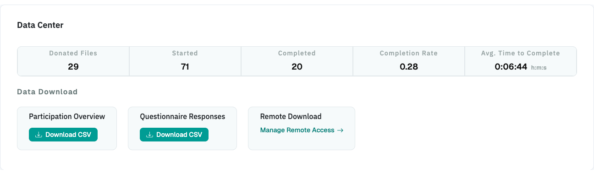

# Data Center

The Data Center is where you get the data you collected and follow your project's progress.
To open it, go to the [Project Hub](../project_hub.md) and 
scroll to the Data Center section of the Project Hub.

{ width="95%" }

- [Download](data_download.md): Download the donations and questionnaire responses.
- [Statistics](participation_statistics.md): See how many people took part, donated their
  data, and completed the study.
- [APIs](../topics/apis.md): Download data with a script, for example to update your
  analysis automatically while the study is running.

To check events and errors, for example failed uploads, open **Project Logs** in the
Project Hub. See [Project Logs](project_logs.md).

!!! note "Enhanced encryption"

    For projects with
    [enhanced encryption](../create_project.md#advanced-options-enhanced-encryption),
    you need the project password to download data, both here and through the API.

!!! warning "Store downloaded data securely"

    Downloaded files aren't encrypted. Store them according to your data protection plan,
    for example on an encrypted drive that only your team can access.

