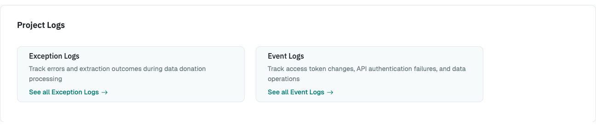

# Project Logs

The project logs help you spot problems while your study is running, for example
participants whose files DDM can't read, or a Blueprint that doesn't match the platform's
current export. Check them after you launch your project and regularly while it runs.

To open them, go to the [Project Hub](../project_hub.md) and click **Project Logs**.

{ width="95%" }

There are two logs:

- The [Exception Log](#exception-log) lists problems that occurred during participation.
- The [Event Log](#event-log) lists actions on the project, such as data downloads and
  deletions.

## Exception Log

Each entry shows:

- When the problem occurred.
- The type of problem (see below).
- The participant and Blueprint concerned, if any.
- Whether it occurred in the participant's browser (client side) or on the server (server
  side).
- A message with details.

### Problems in the Participant's Browser

These problems occur while DDM processes the uploaded file in the participant's browser.

**Problems with the participant's file.** Usually, the participant uploaded the wrong file.
If many participants are affected, the platform may have changed its export, or your
instructions may be unclear.

| Code                        | Meaning                                                                                                       |
|-----------------------------|---------------------------------------------------------------------------------------------------------------|
| `INVALID_ZIP`               | The Uploader expects a ZIP file, but the participant uploaded a different file type.                          |
| `ZIP_READ_FAIL`             | The ZIP file couldn't be read. The message contains the error and, for a nested ZIP file, its path and depth. |
| `NO_FILE_MATCH`             | The ZIP file doesn't contain a file that matches the Blueprint's **File paths**.                              |
| `STRING_CONVERSION_ERROR`   | The file's content couldn't be read as text.                                                                  |
| `PARSING_ERROR`             | The file couldn't be read in the expected format (JSON, CSV, or TXT).                                         |
| `EXTRACTION_ROOT_NOT_FOUND` | The file doesn't contain the Blueprint's **Extraction Root**.                                                 |
| `NESTED_PATH_NOT_FOUND`     | The file doesn't contain the Blueprint's **Nested loop path**.                                                |

**Problems with your configuration.** Fix these in the
[Blueprint](../data_collection_configuration/datadonation/datadonation_configuration.md#blueprint-configuration).

| Code                      | Meaning                                                                                                                 |
|---------------------------|-------------------------------------------------------------------------------------------------------------------------|
| `INVALID_REGEX`           | A regular expression in **File paths** isn't valid.                                                                     |
| `INVALID_FIELD_REGEX`     | A regular expression in a field name isn't valid.                                                                       |
| `NO_FIELDS_TO_EXTRACT`    | No field has **Keep in donation** enabled. In older logs, this is called `NO_EXTRACTION_RULES`.                         |
| `MORE_THAN_ONE_KEY_MATCH` | More than one field in the file matches a field's **Expected name**. Make the name or regular expression more specific. |

**Unexpected problems.** If these occur, please check carefully and consider [reporting an issue](../../issues.md).

| Code                           | Meaning                                                 |
|--------------------------------|---------------------------------------------------------|
| `FILE_PROCESSING_FAIL_GENERAL` | An unexpected error occurred while processing the file. |
| `UNSUPPORTED_BP_FORMAT`        | The Blueprint's file format isn't supported.            |

### Extraction Summaries

These entries aren't problems. DDM writes them once per Blueprint every time it processes a
file successfully. Use them to check whether your Blueprint extracts what you expect.

| Code                   | Contains                                                                                                                                                                                                                                                                                                                                                                                                  |
|------------------------|-----------------------------------------------------------------------------------------------------------------------------------------------------------------------------------------------------------------------------------------------------------------------------------------------------------------------------------------------------------------------------------------------------------|
| `EXTRACTION_STATS`     | Counts of the extraction: rows in total (`nRowsTotal`), rows with a missing field (`nRowsMissingField`), rows removed by Extraction Rules (`nRowsFilteredOut`), and which fields weren't found how often (`noKeyMatches`). With a **Nested loop path**, also the number of sub-entries (`nNestedRowsTotal`) and of sub-entries skipped because of **Nested expected fields** (`nNestedRowsMissingField`). |
| `EXTRACTION_LOG`       | How often each Extraction Rule was applied, by rule ID.                                                                                                                                                                                                                                                                                                                                                   |
| `EXTRACTED_FIELDS_MAP` | Which field in the file was matched to which **Expected name**. Useful if you use regular expressions.                                                                                                                                                                                                                                                                                                    |

For example, if `nRowsFilteredOut` is close to `nRowsTotal` for most participants, your
Extraction Rules may remove more than intended.

### Problems on the Server

Server-side problems don't have codes. Their message starts with where they occurred:

- **Data Donation Processing Exception**: The server couldn't process a donation, for
  example because the uploaded data was incomplete or invalid.
- **Questionnaire Post Exception**: The server couldn't save questionnaire responses, for
  example because a response didn't match the question's options.

Problems in the questionnaire are logged only on the server.

## Event Log

The Event Log records:

- Deleted API tokens.
- API requests that failed authentication or were denied.
- Data downloads, whether successful, failed, or denied.
- Data deletions, whether successful, failed, or denied.
- Deletions of individual participants, whether successful, failed, or denied.
- Problems in the participant's browser that couldn't be assigned to a participant, for
  example because their session had expired.
