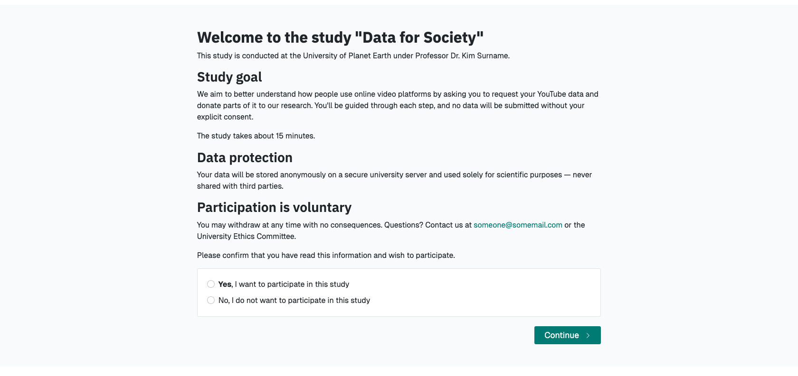

# Briefing Page

The briefing page is the first part of your project and is used to onboard
participants and brief them about your project and the steps ahead.
Additionally, you can obtain explicit consent for the general study participation
by requiring participants to confirm that they have read and agree with the provided
information.

## Participants' Perspective

To the participants, the briefing page will look something like this:

{ width="95%" }

## Configuration Options

You can access the configuration options for the briefing page in 
_Project Hub > Data Collection Configuration > Briefing_.
To configure the briefing page, you have the following options.

!!! setting-details "Settings"

    ---

    **Briefing Text**

    Text displayed to participants on the briefing page.

    !!! tip

        In the briefing text, you can make use of dynamic template functionalities.
        You can read more about how to use dynamic templates
        [here](../topics/templating_features.md).

    ---

    **Briefing Consent Mandatory**

    If enabled, participants will have to provide explicit participation consent
    before they can advance to the data donation. If a participant does indicate that they
    do not consent, they will be redirected to the debriefing page.

    ---

    **Response Consent**

    The label displayed to participants to indicate consent.

    ---

    **Response Non-Consent**

    The label displayed to participants to reject consent.
