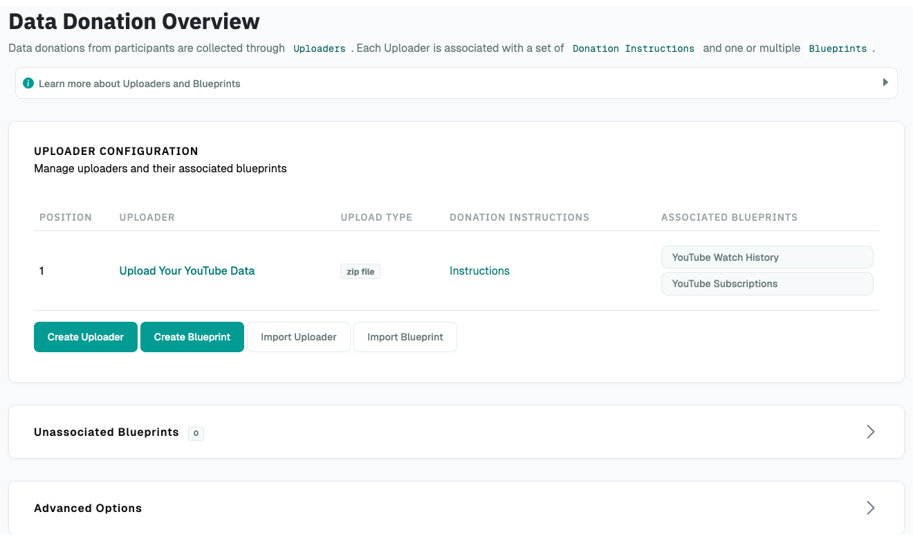
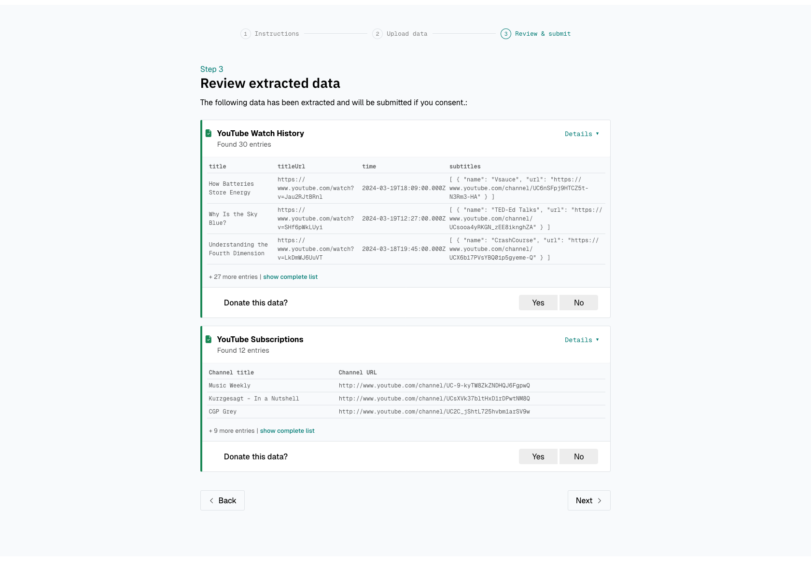
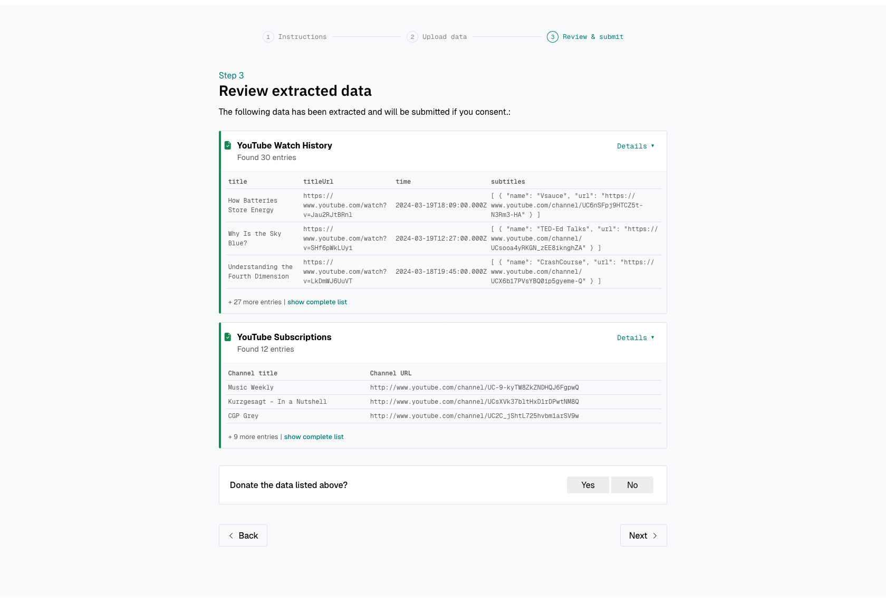

# Data Donation Configuration

You configure the data donation step with three building blocks:

- **Uploaders**: An Uploader is an upload form for one file, either a single file or a ZIP
  file. If participants should donate data from several platforms, create one Uploader per
  platform.
- **Instructions**: Each Uploader can have instructions that show participants how to
  request and download the file from the platform.
- **Blueprints**: A Blueprint defines which data DDM extracts from the uploaded file. Each
  Uploader has one or more Blueprints, for example one for the watch history and one for the
  search history in the same YouTube export.

To configure the data donation step, open the [Project Hub](../../project_hub.md) and, under
**Data Collection Configuration**, click **Data Donation**:

{ width="95%" }

## Uploader Configuration

!!! setting-details "Settings"

    ---

    **Upload Type**

    **Single file** if participants upload one file, such as a CSV or JSON file. 
    **Zip file** if they upload a ZIP file, as most platforms provide.

    ---

    **Name**

    Internal name of the Uploader. Participants don't see it. Must be unique within the
    project.

    ---

    **Extract nested zip files**

    If enabled, DDM also opens ZIP files inside the uploaded ZIP file, so that Blueprints can
    extract data from the files they contain.

    In the file paths of a Blueprint, files inside a nested ZIP file include the ZIP file's
    name. For example, `inner.json` inside `nested.zip` has the path `nested.zip/inner.json`.

    ---

    **Extraction depth**

    How many levels of nested ZIP files DDM opens. With `1`, DDM opens ZIP files inside the
    uploaded ZIP file, but not ZIP files inside those. With `0`, DDM opens only the uploaded
    ZIP file.

    ---

    **Display name**

    The Uploader's name in the header of the upload form, as participants see it, for
    example "YouTube".

    ---

    **Display position**

    If you use several Uploaders, the order in which they're shown. Uploaders with a lower
    number are shown first.

    ---

    **All-in-one consent**

    By default, participants consent separately to the data of each Blueprint. With
    all-in-one consent, they consent once to all extracted data, at the bottom of the page.

    <div class="grid" markdown>

    All-in-one consent disabled:
    { width="95%" }

    All-in-one consent enabled:
    { width="95%" }

    </div>

## Instruction Configuration

After you create an Uploader, you can add instructions to it. Instructions consist of one
or more pages, which participants go through with **Next** and **Back** buttons. If an
Uploader has no instructions, participants go straight to the upload form.

!!! setting-details "Settings"

    ---

    **Text**

    The text of the instruction page. You can also upload and add images or GIFs, for
    example screenshots that show where to request the data on the platform.

    !!! tip "Let participants continue later"

        Requesting data from a platform can take hours or days. To let participants return
        later, show them their participant ID with the variable `{{ participant_id }}`. It
        appears as a code like `IPI2wHDWrHODDRKuo8zo101S`. See
        [Continuation](../../topics/continuation.md).

    ---

    **Page number**

    The position of the page in the instructions.

## Blueprint Configuration

A Blueprint processes the uploaded file in these steps:

1. **Find the file:** In a ZIP file, find the file that matches the **File paths**.
2. **Check the file:** Check that it has the expected format and contains the
   **Expected fields**.
3. **Select the fields:** Keep only the [Relevant Fields](#relevant-fields).
4. **Filter and clean:** Apply the [Extraction Rules](#extraction-rules), for example to
   remove entries before a certain date or to anonymize email addresses.

Participants then review the result before they donate it.


### General Settings

!!! setting-details "Settings"

    ---

    **Name**

    Internal name of the Blueprint. Participants don't see it.

    ---

    **Associated Uploader**

    The Uploader whose file this Blueprint processes.

### Display Settings

!!! setting-details "Settings"

    ---

    **Display name**

    The name participants see above the extracted data. Choose a name that describes the
    data, for example "Watch History" or "Liked Posts".

    ---

    **Description**

    Optional. Describes the extracted data for participants, for example *"The date you
    watched each video and the link to the video"*.

    ---

    **Display order**

    The order of the Blueprints on the page. Blueprints with a lower number are shown first.
    Blueprints with the same number are shown in the order they were created.

### Data Extraction Configuration

!!! setting-details "Settings"

    ---

    **File paths**

    Only needed if the Uploader expects a ZIP file. The path of the file inside the ZIP
    file. For example, if `some_data.json` is at the top level of the ZIP file, enter
    `some_data.json`.

    Paths are matched from the end: `data.json` matches both `root/data.json` and
    `root/some-folder/data.json`. If a path matches more than one file, DDM extracts data
    from all of them, so make the path as specific as possible.

    You can add several paths, for example if the file name differs between platform
    languages. DDM tries them in order, lowest number first: the first path with at least
    one match is used (and all files matching it are extracted), and any later paths are
    ignored.

    !!! tip "Using regular expressions in file paths"

        A *regular expression* (regex) is a pattern that matches several possible texts.
        For an introduction, see
        [Regular expressions on MDN](https://developer.mozilla.org/en-US/docs/Web/JavaScript/Guide/Regular_expressions).
        To test a pattern, use [regex101](https://regex101.com/) with the "ECMAScript
        (JavaScript)" flavor.

        Examples:

        - `^MyActivities\.json$`: A file named `MyActivities.json` at the top level of the
          ZIP file.
        - `^SpecificFolder/MyActivities\.json$`: A file named `MyActivities.json` in the
          folder `SpecificFolder` at the top level.
        - `.*/MyActivities\.json$`: A file named `MyActivities.json` in any folder.
        - `^(MyActivities|MeineAktivitäten|MieAttivita)\.json$`: A file at the top level
          named `MyActivities.json`, `MeineAktivitäten.json`, or `MieAttivita.json`, for
          example the same file in different platform languages.

        Patterns are case-sensitive: `myactivities\.json` doesn't match `MyActivities.json`.
        To allow both spellings, list them in the pattern, for example
        `[Mm]y[Aa]ctivities\.json`.

        For files inside nested ZIP files, see
        [Extract nested zip files](#uploader-configuration).

    ---

    **Expected File Format**

    The format of the file: JSON, CSV, or TXT.

    ---

    **Expected fields**

    The fields the file must contain. If the file doesn't contain **all** of them, DDM
    extracts nothing from it. Put each field name in double quotes and separate them with
    commas, for example `"Field A", "Field B"`.

    ---

    **Expected fields use regex matching**

    Enable this if **Expected fields** contains regular expressions instead of exact field
    names. Like all regular expressions in DDM, they're case-sensitive.

    ---

    **Array join separator**

    Some fields contain several values, for example the lines of a message. DDM combines
    them into one text, separated by this character. The default, `\n`, puts each value on
    its own line: `["A", "B"]` becomes `A` and `B` on two lines.

### JSON-Specific Settings

!!! setting-details "Settings"

    ---

    **Extraction Root**

    Where in the file the data to extract is. Leave it empty if the data is at the top
    level of the file. If the data is nested inside other fields, enter the path to it, with
    field names separated by dots.

    For example, to extract the names and dates of `real_friends` from this file, enter
    `friends.real_friends`:

    ```json
    {
      "friends": {
        "real_friends": [{"name": "Alice", "date": "2024-01-01"}],
        "fake_friends": [{"name": "Bob", "date": "2024-02-01"}]
      }
    }
    ```

#### Nested Loop Settings

Sometimes each entry in a file contains a list of sub-entries that you want as separate
rows. For example, a ChatGPT export has one entry per conversation, and each conversation
contains a list of messages:

```json
[
  {
    "conversation_id": "conv-1",
    "title": "Weekend Trip Ideas",
    "mapping": [
      {"message": {"author": "user", "content": "Where should we go this weekend?"}},
      {"message": {"author": "assistant", "content": "How about a hike near the lake?"}}
    ]
  },
  {
    "conversation_id": "conv-2",
    "title": "Restaurant Ideas",
    "mapping": [
      {"message": {"author": "assistant", "content": "some content 2"}}
    ]
  }
]
```

By default, DDM extracts one row per conversation and can't reach the individual messages.
With **Nested loop path** set to `mapping`, DDM creates one row per message and repeats the
conversation's fields in each row:

| conversation_id | title              | author    | content                          |
|-----------------|--------------------|-----------|----------------------------------|
| conv-1          | Weekend Trip Ideas | user      | Where should we go this weekend? |
| conv-1          | Weekend Trip Ideas | assistant | How about a hike near the lake?  |
| conv-2          | Restaurant Ideas   | assistant | some content 2                   |

This also works if `mapping` is an object instead of a list, for example
`"mapping": {"some_uuid": {"message": {...}}}`. DDM then ignores the keys (`some_uuid`) and
uses the values.

All settings in this section apply only to JSON Blueprints with a **Nested loop path**.

!!! setting-details "Settings"

    ---

    **Nested loop path**

    The field that contains the sub-entries, for example `mapping`. For a field inside
    another field, separate the names with dots, for example `data.mapping`. Leave it empty
    if you don't need it.

    To extract fields of the sub-entries, add them as [Relevant Fields](#relevant-fields)
    with the scope **Nested level**, for example `message.author` and `message.content`.

    ---

    **Nested expected fields**

    Like **Expected fields**, but checked for each sub-entry. DDM skips sub-entries that
    don't contain all of these fields and still processes the rest of the entry. Put each
    field name in double quotes and separate them with commas, for example
    `"Field A", "Field B"`.

    ---

    **Nested expected fields use regex matching**

    Enable this if **Nested expected fields** contains regular expressions.

    ---

    **Group entries by parent item**

    By default, participants see all sub-entries (for example, all messages from all
    conversations) in one list. If enabled, they see them grouped by entry, for example all
    messages of a conversation together, with the conversation's title shown once above
    them.

    ---

    **Allow item exclusion**

    If enabled, participants can remove individual entries, for example a single
    conversation, before they donate. Otherwise, they can only donate or decline all data
    of the Blueprint. Requires **Group entries by parent item**.

### CSV-Specific Settings

!!! setting-details "Settings"

    ---

    **CSV Delimiter**

    The character that separates values in the file, for example `,`, `;`, or `\t` (tab).
    If you leave it empty, DDM detects it from the file.

### TXT-Specific Settings

For example, for this file:

```txt
Datum: 2026-04-01 14:09:16 UTC
Link: https://example.com/video/1

Datum: 2026-04-02 15:30:48 UTC
Link: https://example.com/video/2
```

set **Record/entry separator** to `\n\n` (blank line), **Field separator** to `\n` (line
break), and **Key-value separator** to `:`. DDM extracts two entries, each with the fields
`Datum` and `Link`.

!!! note "Entering line breaks"

    In the separator settings, type `\n` (a backslash followed by "n") for a line break and
    `\n\n` for a blank line. Don't paste an actual line break into the field.

!!! setting-details "Settings"

    ---

    **Record/entry separator**

    What separates one entry from the next, for example `\n\n` for a blank line or `\n` for
    a line break.

    ---

    **Field separator**

    What separates the fields within an entry, for example `\n` if each field is on its own
    line.

    ---

    **Key-value separator**

    What separates a field's name from its value, for example `:` in `Name: John` or `=` in
    `name=John`.

    ---

    **Skip header lines**

    How many lines to skip at the start of the file, for example a title or metadata.

    ---

    **Skip footer lines**

    How many lines to skip at the end of the file, for example a summary.

    ---

    **Ignore blank lines**

    If enabled, DDM ignores empty lines within an entry instead of treating them as part of
    a field.

    ---

    **Trim whitespace**

    If enabled, DDM removes spaces at the start and end of each entry and each field.

### Relevant Fields

Once DDM has found and checked the file, it extracts only the fields you define here. You
can also rename fields, for example to get the same column name for files in different
platform languages.

!!! setting-details "Settings"

    ---

    **Scope**

    **Root level** (the default) reads the field from the entry. **Nested level** reads it
    from a sub-entry (see [Nested Loop Settings](#nested-loop-settings)), for example
    `message.author` in the ChatGPT example. **Nested level** is only available for JSON
    Blueprints with a **Nested loop path**.

    ---

    **Expected name**

    The field's name in the file, or a regular expression if **Match regex** is enabled,
    for example to match the same field in different platform languages. Without regex, you
    can reach a field inside another field with dots, for example `message.author.role`.

    ---

    **Match regex**

    Enable this if **Expected name** is a regular expression instead of an exact name.

    ---

    **Rename to**

    Optional. The field's name in the extracted data. If empty, DDM uses the
    **Expected name**. Useful with regular expressions, so the column has a predictable
    name.

    ---

    **Keep in donation**

    If enabled, the field is part of the donated data. If disabled, you can still use the
    field in Extraction Rules (for example, to filter by date) without collecting it.

### Extraction Rules

Extraction Rules filter and clean the extracted data. DDM applies them one after another,
in the order you define. Each rule either **removes entries** that meet a condition or
**changes the text** of a field.

!!! info

    Rules don't decide which fields are kept; **Keep in donation** does (see
    [Relevant Fields](#relevant-fields)). You only need rules to filter or change data.

!!! setting-details "Settings"

    ---

    **Execution Order**

    The order in which the rules are applied. Rules with a lower number are applied first.

    ---

    **Name**

    Internal name of the rule. It's not the name of the field.

    ---

    **Field**

    The field the rule checks or changes. Must match the field's **Expected name** or, if
    set, its **Rename to** value.

    ---

    **Extraction Operator**

    What the rule does. See [Operators](#operators).

    ---

    **Comparison Value**

    The value or regular expression the field is compared with.

    ---

    **Replacement Value**

    Only for **Replace match (regex)**: the text that replaces the matching parts.

#### Operators

**Operators that remove entries.** Each of these operators **removes** every entry for which
the condition is true.

| Extraction Operator           | Removes an entry if the field…                    | Works with                  |
|-------------------------------|---------------------------------------------------|-----------------------------|
| Equal (==)                    | equals the comparison value.                      | Text, numbers, dates[^1]    |
| Not Equal (!=)                | doesn't equal the comparison value.               | Text, numbers, dates[^1]    |
| Greater than (>)              | is greater than the comparison value.             | Numbers, dates[^1]          |
| Smaller than (<)              | is smaller than the comparison value.             | Numbers, dates[^1]          |
| Greater than or equal (>=)    | is greater than or equal to the comparison value. | Numbers, dates[^1]          |
| Smaller than or equal (<=)    | is smaller than or equal to the comparison value. | Numbers, dates[^1]          |
| Delete row when match (regex) | matches the regular expression.                   | Any value (treated as text) |

For the greater/smaller operators, entries whose field contains text are kept.

**Operators that change text.**

| Extraction Operator   | What it does                                                                                      | Works with                  |
|-----------------------|---------------------------------------------------------------------------------------------------|-----------------------------|
| Delete match (regex)  | Deletes the parts of the field that match the regular expression.                                 | Any value (treated as text) |
| Replace match (regex) | Replaces the parts of the field that match the regular expression with the **Replacement Value**. | Any value (treated as text) |

Examples:

- **Delete match (regex)** with `^Watched ` turns `Watched video XY` into `video XY`.
- **Replace match (regex)** with `[\w.-]+@([\w-]+\.)+[\w-]{2,}` and the replacement value
  `_anonymized_` turns `some text email@address.com` into `some text _anonymized_`.
- **Delete row when match (regex)** with `^Watched ` removes every entry whose field starts
  with `Watched `.

[^1]: DDM recognizes dates in ISO, RFC 2822, or HTTP format, for example
    `2026-04-01T14:09:16Z`, but only if the field and the comparison value use the same
    format. Otherwise, it compares them as text.

### Backup Blueprints (Advanced)

A backup Blueprint is a fallback: if a Blueprint can't extract data from a participant's
file, for example because the platform changed its export format, DDM tries the backup
instead. Participants see the result of whichever Blueprint succeeds. If the main Blueprint
succeeds, DDM doesn't use the backups.

For example, `Watch History` expects the current JSON export. A second Blueprint,
`Watch History (old format)`, expects the TXT export that the platform used before, with
**Backup for** set to `Watch History`. If a participant uploads an old export, DDM uses the
backup.

!!! setting-details "Settings"

    ---

    **Backup for**

    The Blueprint that this Blueprint is a backup for. Leave it empty if this isn't a
    backup. You can only choose Blueprints of the same Uploader. A backup can't have its own
    backup.

    ---

    **Backup priority**

    If a Blueprint has several backups, DDM tries the one with the lowest number first.

## Advanced Options

Under **Advanced Options**, you can edit the texts of the upload form, such as button labels
and messages, for all Uploaders of the project.
