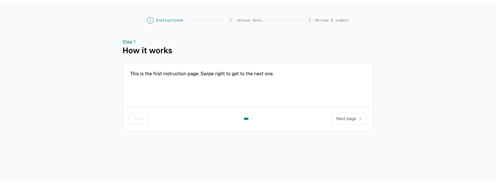
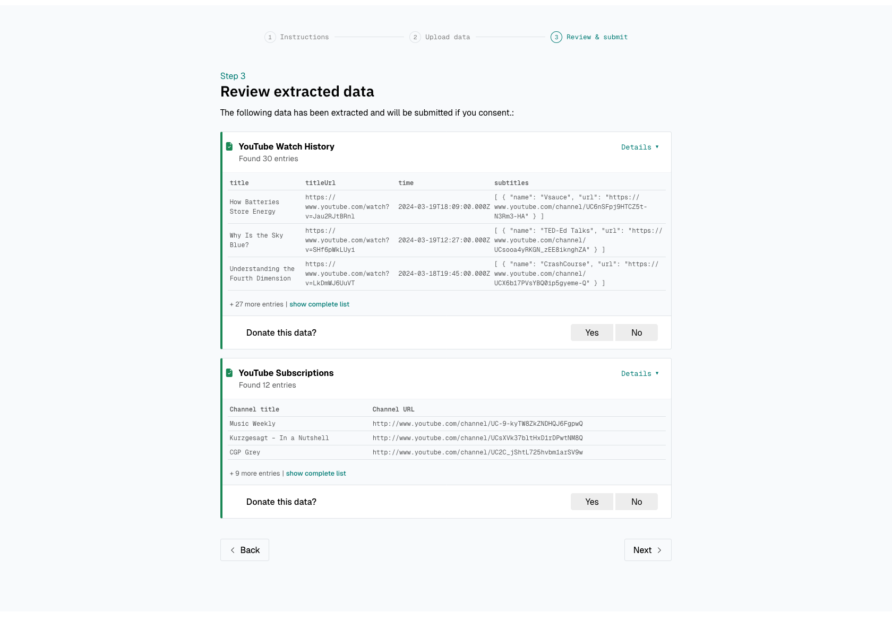

# Data Donation

On the data donation page, participants upload their data, review it, and decide whether to
donate it. The page follows the [briefing page](../briefing.md).

!!! info "Donated data stays on the participant's device until they consent"

    DDM checks, extracts, and filters the uploaded data in the participant's browser.
    The content of the donation is sent to your server only after the participant reviews
    it and clicks **Transmit data**.

    Before consent, DDM may send technical information about the uploaded file, such as
    its file structure, to help you diagnose problems (see [Project Logs](../../data_center/project_logs.md)).

## Participants' Perspective

Participants go through three steps:

1. **Instructions:** Participants read how to request and download their data from the
   platform.

    { width="95%" }

2. **Upload:** Participants upload the file they received from the platform.
3. **Review and consent:** Participants see the data that DDM extracted from their file and
   decide whether to donate it.

    { width="95%" }

## Researchers' Perspective

Between upload and review, DDM processes the file according to the rules you define:

1. **Check the file:** DDM verifies that the participant uploaded the expected file.
2. **Extract and filter:** DDM keeps only the data your extraction rules ask for and removes
   everything else.

Participants then review only this extracted data, so they know exactly what they donate.

To set up the instructions and extraction rules, see
[Data Donation Configuration](datadonation_configuration.md).
