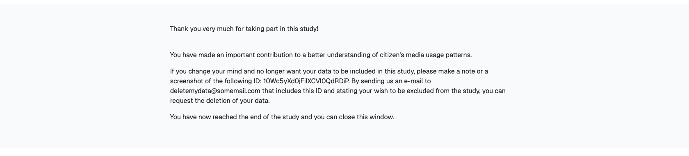

# Debriefing Page

The debriefing page is the last page participants see. Use it to thank participants,
explain the purpose of the study, and, if needed, send them on to the next part of your
study, such as a follow-up survey.

## Participants' Perspective

{ width="95%" }

To show a button that takes participants to another website, such as your survey, see
[General Project Settings → Redirect Configuration](../general_project_settings.md#redirect-configuration).

## Configuration

Open the [Project Hub](../project_hub.md) and go to
**Data Collection Configuration → Debriefing**.

!!! setting-details "Settings"

    ---

    **Debriefing text**

    The text shown on the debriefing page.

### Show Different Texts to Different Participants

You can adapt the debriefing text to what happened during participation, for example to
tell participants whose files couldn't be processed that they aren't eligible for a reward.

To do this, add conditions to the text. A condition starts with ``, can have
alternatives (``, ``), and ends with ``. DDM shows only the
text of the first condition that applies:

```django

    Thank you very much for participating in our study. With your data donation, you made a
    great contribution to our research.

    Thank you for your time. Unfortunately, no data could be extracted from your upload, so
    you aren't eligible for the participation reward.

    Thank you for your time.

```

In this example:

- Participants who donated at least some data see the first text.
- Participants who donated nothing, and from whose upload no data could be extracted, see
  the second text.
- Everyone else, for example participants who declined to donate, sees the third text.

For all `donation_info` values and other variables, see
[Template Rendering → Available Variables](../topics/templating_features.md#available-variables).
