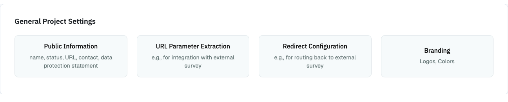

# Data Collection Configuration

Configure what participants see and do, step by step. Participants go through the steps in
this order:

1. [Briefing Page](briefing.md): Introduces your study when participants open the link.
2. [Data Donation](datadonation/datadonation_overview.md): Participants upload their data,
   review it, and decide what to donate. You define which files you expect, which data is
   extracted, and the instructions participants follow.
3. [Questionnaire](questionnaire/questionnaire_overview.md) (optional): Questions shown after
   the donation, which can refer to the donated data.
4. [Debriefing Page](debriefing.md): The last page, for example to thank participants or send
   them on to a follow-up survey.

!!! info "The order is fixed"

    You can't change the order of the steps or skip the briefing and debriefing pages. Only
    the questionnaire is optional.

    To ask questions *before* the donation, use an external survey tool (for example,
    SoSciSurvey or Qualtrics) first and send participants on to DDM with their ID in the link.
    See [URL Parameter Extraction](../general_project_settings.md#url-parameter-extraction).

To configure a step, open the [Project Hub](../project_hub.md) and select it under
**Data Collection Configuration**:

{ width="90%" }
