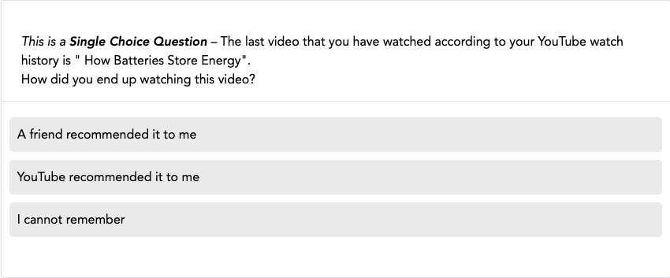
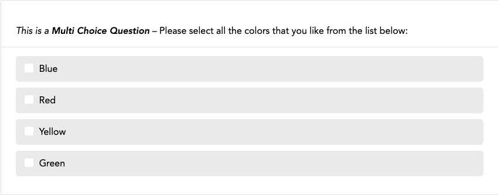
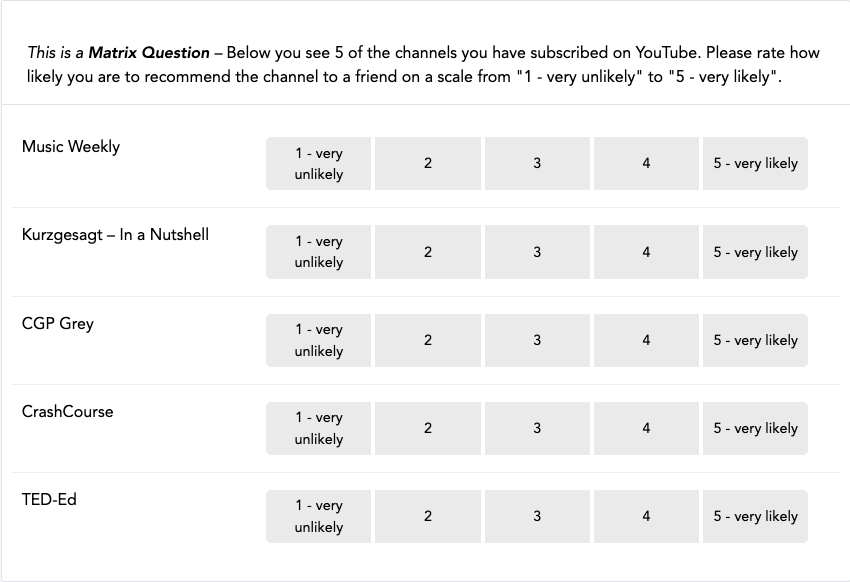
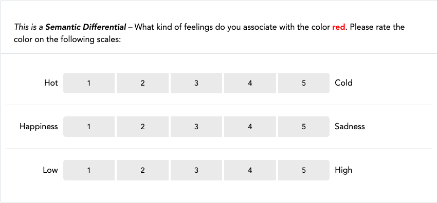
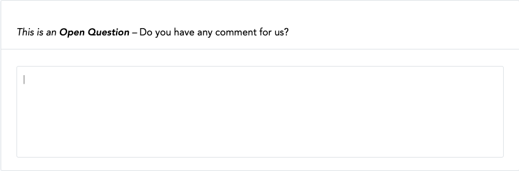
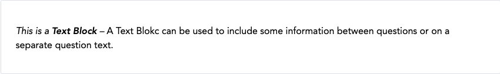

# Questionnaire Configuration

This page describes the settings for questions and their items, scales, and filters. To
configure the questionnaire, open the [Project Hub](../../project_hub.md) and, under
**Data Collection Configuration**, click **Questionnaire**.

## Question Types

- **Single Choice Question**: Participants choose one answer.

    { width="80%" }

- **Multi Choice Question**: Participants choose one or more answers.

    { width="80%" }

- **Matrix Question**: Several items rated on the same scale.

    { width="80%" }

- **Semantic Differential**: Several items rated on a scale between two opposite terms.

    { width="80%" }

- **Open Question**: Participants answer in their own words.

    { width="80%" }

- **Text Block**: Text without a question, for example an introduction to the next page.

    { width="80%" }

## General Settings

These settings are available for all question types.

!!! setting-details "Settings"

    ---

    **Name**

    Internal name of the question. Participants don't see it.

    ---

    **Blueprint**

    Whether the question is shown to everyone or depends on a
    [Blueprint](../datadonation/datadonation_configuration.md#blueprint-configuration):

    - **General questions** are shown to all participants, whether or not they donated data.
    - **Questions linked to a Blueprint** are shown only to participants for whom that
      Blueprint extracted data. If no data was extracted, because the extraction failed,
      wasn't attempted, or the Extraction Rules removed all entries, the question isn't
      shown.

    Questions linked to a Blueprint can refer to the donated data. See
    [Data Integration](questionnaire_data_integration.md).

    ---

    **Page**

    The number of the page the question is shown on.

    ---

    **Index**

    The order of the questions on the same page. Questions with a lower number are shown
    first.

    ---

    **Variable Name**

    The question's column name in the data download. For questions with items, each item
    gets its own column, named `<variable name>-<item value>`. For example, the item with the
    value `2` in the question `media_use` becomes `media_use-2`.

    ---

    **Text**

    The question text that participants see.

    ---

    **Requirement level**

    Whether participants must answer the question:

    - **Not required**: Participants can skip the question.
    - **Soft**: If participants skip the question, they see a reminder once. They can then
      continue without answering.
    - **Hard**: Participants can't continue without answering.

    ---

    **Randomize items**

    If enabled, the items of the question are shown in random order. To randomize only some
    items, use **Randomize** on the [items](#question-items) instead.

## Settings for Specific Question Types

### Open Question

!!! setting-details "Settings"

    ---

    **Input type**

    What participants can enter: **text** (anything, the default), **number** (only
    numbers), or **email** (only valid email addresses).

    ---

    **Minimum input length**

    The minimum number of characters. If empty, there's no minimum.

    ---

    **Maximum input length**

    The maximum number of characters. If empty, there's no maximum.

    ---

    **Minimum input value**

    Only for the input type **number**: the smallest number allowed. If empty, there's no
    minimum.

    ---

    **Maximum input value**

    Only for the input type **number**: the largest number allowed. If empty, there's no
    maximum.

    !!! warning "Restrictions are only hints"

        If participants enter something that doesn't meet the input type or limits, they see
        a hint, but they can still continue. Your data can therefore contain values outside
        these limits, so check them when you analyze the data.

    ---

    **Display**

    Only for the input type **text**: **small** (a one-line field, the default) or a larger
    field with several lines.

    ---

    **Multi item response**

    If enabled, you can add [items](#question-items), and participants answer each item in
    its own field. If disabled, the question has one field below the question text.

### Matrix Question

!!! setting-details "Settings"

    ---

    **Show scale headings**

    Whether the **Heading label** of each [scale point](#scale-configuration) is shown above
    the scale.

## Question Items

Single Choice Questions, Multi Choice Questions, Matrix Questions, and Semantic
Differentials consist of items: the answer options or the statements that participants rate.

!!! setting-details "Settings"

    ---

    **Index**

    The order of the items. Items with a lower number are shown first.

    ---

    **Label**

    The item's text. For Semantic Differentials, the term on the left side of the scale.
    Supports [basic formatting](#formatting-labels).

    ---

    **Label Right**

    Only for Semantic Differentials: the term on the right side of the scale. Supports
    [basic formatting](#formatting-labels).

    ---

    **Value**

    Identifies the item in the data download. For Single Choice Questions, the value of the
    selected item is saved. For the other question types, the value is part of the item's
    column name (see **Variable Name** under [General Settings](#general-settings)).

    ---

    **Randomize**

    If enabled for some items, only those items swap places randomly. The others stay in the
    position set by their **Index**.

    ---

    **Delete**

    Deletes the item when you click **Save**.

## Scale Configuration

For Matrix Questions and Semantic Differentials, participants rate each item on a scale.

!!! setting-details "Settings"

    ---

    **Index**

    The order of the scale points. Scale points with a lower number are shown first.

    ---

    **Input label**

    The text in the scale point's button. Supports [basic formatting](#formatting-labels).

    !!! tip "Long labels"

        If labels are long or the scale has many points, mark where a word may break with
        `&shy;`. For example, `un&shy;decided` is shown as "undecided" if it fits, and
        otherwise as "un-" at the end of one line and "decided" on the next.

    ---

    **Heading label**

    Only for Matrix Questions: the text above the scale point. Supports
    [basic formatting](#formatting-labels).

    ---

    **Value**

    The value saved in the data download when a participant selects this scale point.

    ---

    **Secondary point**

    If enabled, the scale point is shown separately from the main scale, for example for a
    "Don't know" option.

    ---

    **Delete**

    Deletes the scale point when you click **Save**.

## Formatting Labels

**Label**, **Label Right**, **Input label**, and **Heading label** support basic HTML
formatting:

- `<b>` or `<strong>` for **bold**, `<i>` or `<em>` for *italics*, and `<u>` for underlined
  text.
- `` and `` for subscript and superscript.
- ` ` for a line break.
- `` to apply one of the available Bootstrap CSS classes, for example
  ``.

DDM removes all other HTML, including `style` attributes, when you save. You don't get an
error message.

## Filter Configuration

Filters hide questions or items depending on earlier answers, URL parameters, participant
information, or the donation. For example, you can ask a follow-up question only to
participants who answered "Yes" to a previous question.

DDM hides the question or item if the filter conditions are met.
Hidden questions and items are coded as `-77` in the data download.

If all items of a question are hidden, the question is hidden. If all questions on a page
are hidden, participants skip the page.

!!! setting-details "Settings"

    ---

    **Index**

    The order of the conditions. Conditions with a lower number come first.

    ---

    **Combinator**

    How a condition combines with the previous one: **AND** (both must be met) or **OR**
    (at least one must be met). The first condition's combinator is ignored.

    **AND** takes precedence over **OR**. For example, `A OR B AND C OR D` means
    `A OR (B AND C) OR D`.

    ---

    **Comparison Source**

    What the condition checks:

    - **An earlier answer.** For Single Choice Questions and Open Questions, the whole
      question. For Multi Choice Questions, Matrix Questions, Semantic Differentials, and
      Open Questions with **Multi item response**, the individual items. Text Blocks can't be
      used, and a question can't refer to itself.
    - **A URL parameter**, if [URL Parameter Extraction](../../general_project_settings.md#url-parameter-extraction)
      is enabled.
    - **Participant information**: participant ID, start time, end time, whether the
      participant completed the study, and briefing consent (if enabled).
    - **Donation information**: for example, the number of successful or failed donations.
      See [Template Rendering → Available Variables](../../topics/templating_features.md#available-variables).

    ---

    **Comparison Operator**

    How the source is compared with the **Comparison Value**: `Equal (==)`,
    `Not Equal (!=)`, `Greater than (>)`, `Smaller than (<)`, `Greater than or equal (>=)`,
    `Smaller than or equal (<=)`, `Contains`, or `Does not Contain`.

    For Open Questions with an input type other than **number**, only `Equal (==)`,
    `Not Equal (!=)`, `Contains`, and `Does not Contain` are available.

    ---

    **Comparison Value**

    The value the source is compared with.

    ---

    **Delete**

    Deletes the condition when you click **Save**.
