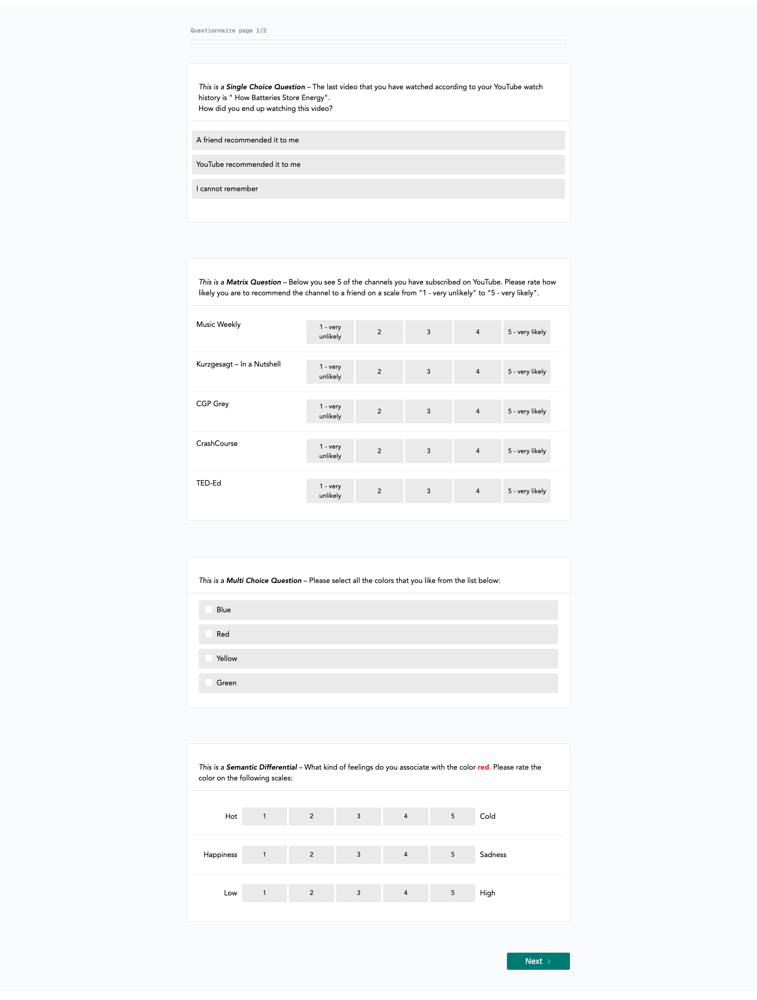

# Questionnaire

You can add an optional questionnaire that participants fill out **after** the data
donation. It has one or more pages, each with one or more questions.

{ width="95%" }

## Question Types

- **Single Choice Question**: Participants choose one answer.
- **Multi Choice Question**: Participants choose one or more answers.
- **Matrix Question**: Several statements rated on the same scale, for example from
  "strongly disagree" to "strongly agree".
- **Semantic Differential**: Several items rated on a scale between two opposite terms,
  for example "boring" and "exciting".
- **Open Question**: Participants answer in their own words.
- **Text Block**: Text without a question, for example an introduction to the next page.

To create and configure questions, see [Questionnaire Configuration](questionnaire_configuration.md).

## Include Donated Data in Questions

Questions can refer to each participant's donated data. For example, if participants
donate their YouTube watch history, you can ask about the last video they watched:

> Why did you watch "How to Bake Sourdough Bread"?

DDM fills in the video title for each participant. See
[Data Integration](questionnaire_data_integration.md).

!!! note

    This isn't available for projects with
    [enhanced encryption](../../create_project.md#advanced-options-enhanced-encryption).

## Responses

To download the responses, see [Download](../../data_center/data_download.md).

### Missing Values

The responses use these codes:

- `-77`: The question or item wasn't shown because of a filter.
- `-99`: The participant saw the question or item but didn't answer it.

### Partial Responses

DDM saves responses as participants go through the questionnaire, not only when they
submit it. If a participant stops after two of four questions, you still receive the
answers to those two questions.

The `questionnaire_complete` column shows whether a participant submitted the last page
(`true`) or stopped partway through (`false`), for example for drop-off analysis.

!!! warning "Mention this in your data protection statement"

    Participants who stop partway may assume that their answers weren't saved. Tell them
    in your [data protection statement](../../general_project_settings.md#public-information)
    that answers are saved as they go.
