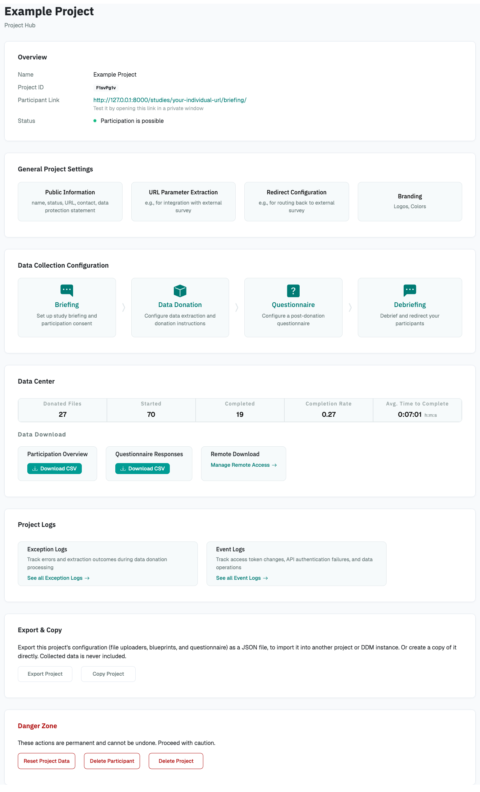
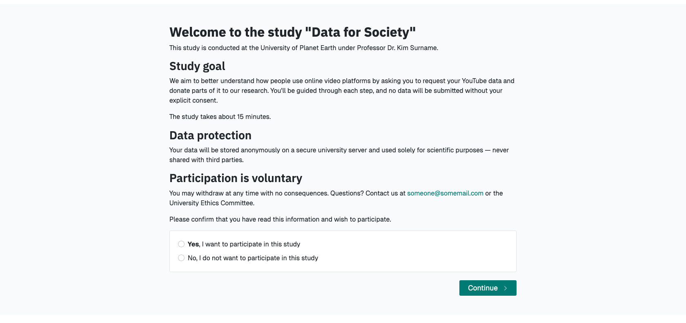
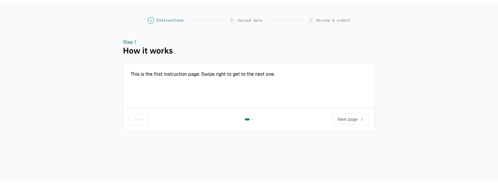
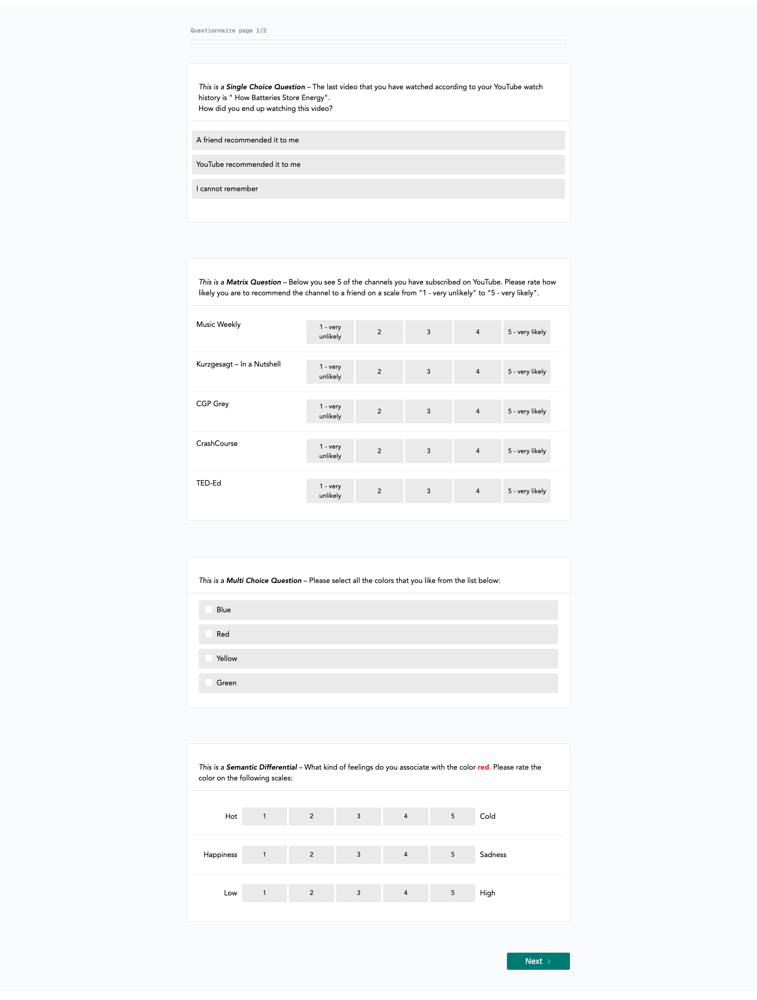
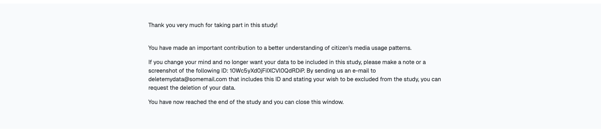

# Researchers

Use this section to set up a data donation project with DDM, collect donations, and
download the data.

## How DDM Works

DDM has two parts: the *Researcher Interface*, where you set up and manage your projects,
and the *Participation Interface*, which your participants go through.

### Researcher Interface

In the Researcher Interface, you create projects, configure what participants see, and
download the collected data. You configure each project from its *Project Hub*:

{ width="75%" }

### Participation Interface

Every participant goes through the briefing page, data donation, and debriefing page; the
questionnaire step is optional. These steps run in order and can't be skipped or reordered.

1. **Briefing page:** Participants learn about your study. You can require participants to
   explicitly confirm their consent to take part before they continue.

    { width="95%" }

2. **Data donation:** Participants follow your instructions to request their data from a
   platform and upload the file. DDM extracts and filters the data in the participant's
   browser - no personal data reaches your server until the participant reviews the
   extracted data and explicitly consents to donating it.

    { width="95%" }

3. **Questionnaire (optional):** Participants answer your questions, which can refer to
   their donated data.

    { width="95%" }

4. **Debriefing page:** Participants see a closing message, for example a thank-you note
   or a link back to your survey.

    { width="95%" }

## Where to Start

1. [Create a project](create_project.md).
2. [Configure the data collection](data_collection_configuration/index.md): briefing,
   data donation, questionnaire, and debriefing.
3. [Test and launch your project](test_and_launch.md) before you share it with participants.
4. [Download the collected data](data_center/data_download.md).
