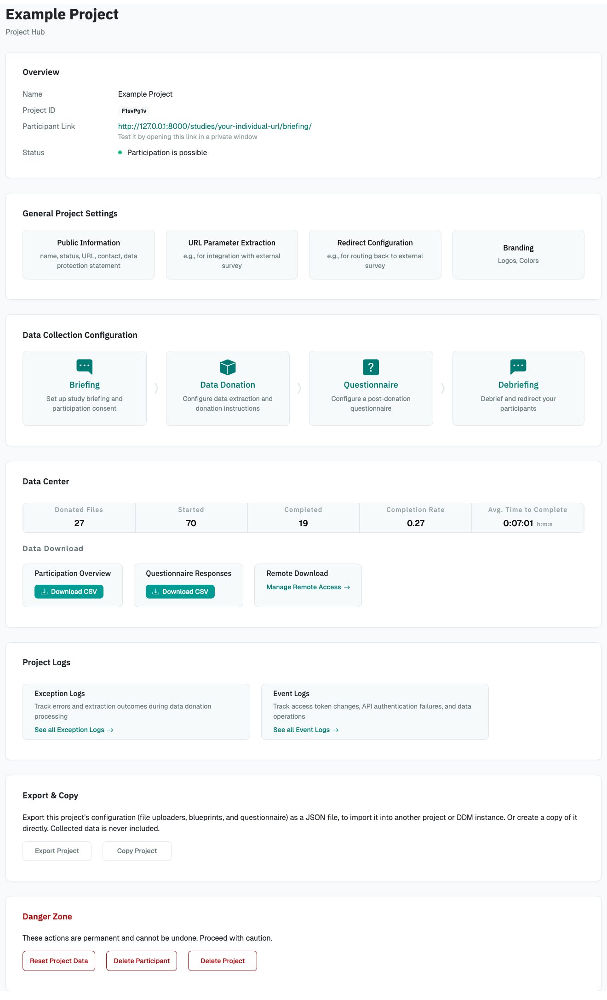

# Project Hub

Each project has a *Project Hub*: the page where you configure the project, share it with
participants, and access the collected data.

{ width="90%" }

The Project Hub has these areas:

- **Overview**: The project's name, ID, and status (active or inactive), the participation
  link to share with participants, and a [test link](test_and_launch.md) to try the
  project yourself.
- **General Project Settings**: The project's name, contact information, data protection
  statement, and other basic settings. See
  [General Project Settings](general_project_settings.md).
- **Data Collection Configuration**: What participants see at each step: briefing, data
  donation, questionnaire, and debriefing. See
  [Data Collection Configuration](data_collection_configuration/index.md).
- **Data Center**: Download the collected data and view participation statistics. See
  [Data Center](data_center/index.md).
- **Project Logs**: Events and errors in your project, for example failed uploads. See
  [Project Logs](data_center/project_logs.md).
- **Export & Copy**: Copy the project or export its configuration, for example to reuse
  it in a new study. See [Export & Copy](export_copy.md).
- **Danger Zone**: Delete the project, all collected data, or the data of individual
  participants. See [Delete a Project or Data](danger_zone.md).
